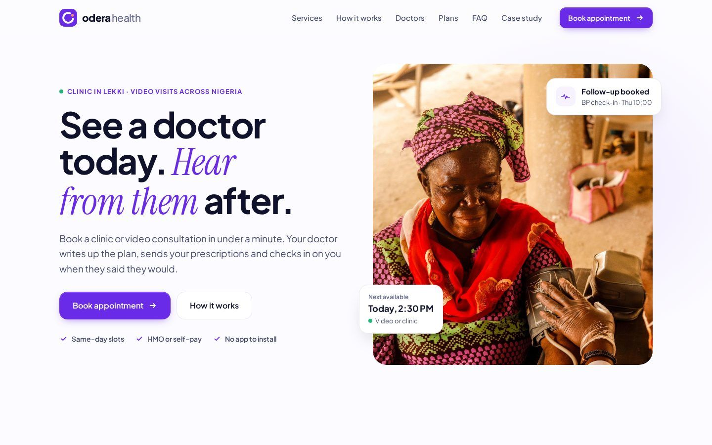
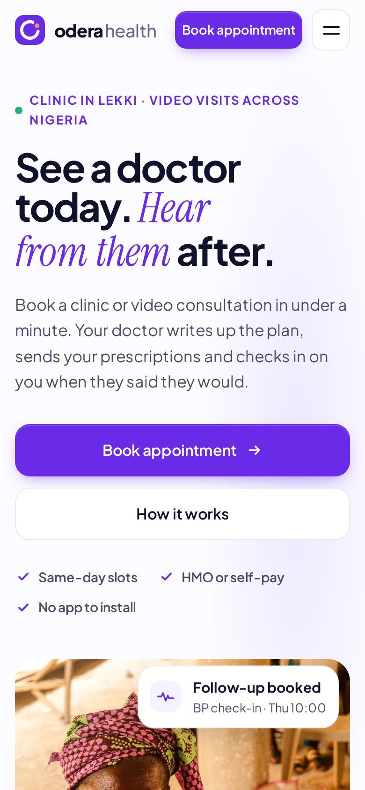

# Odera Health

Concept website for a fictional Lagos clinic, designed by Jola Olayemi.

**Live site:** https://odera-health.sites.tab.bot/

Odera Health is a self-initiated concept, not a real clinic. All names, prices, addresses and phone numbers are sample content.

## Screenshots

## What's in it

- `index.html`: the marketing site: hero, services, how it works, sample doctor profiles, a four-step booking flow that clicks through (service, date and time, details, confirmation), care plans, FAQ, contact and footer.
- `case-study.html`: the case study: problem, goals, design decisions, brand, type and colour system, and mobile screens.
- `assets/`: styles, script, fonts, logo and images.

It is a static site with no build step. Open `index.html` in a browser, or serve the folder with any static server.

## Credits

- **Design:** Jola Olayemi (brand and UX/UI design).
- **Photos:** hero and how-it-works photos are free stock from [Pexels](https://www.pexels.com/), used under the Pexels License. Individual photo links are on the case study page.
- **Sample doctor portraits:** AI-generated; they do not show real people. Doctor names are placeholders.
- **Fonts:** [Plus Jakarta Sans](https://fonts.google.com/specimen/Plus+Jakarta+Sans) and [Instrument Serif](https://fonts.google.com/specimen/Instrument+Serif), both under the SIL Open Font License.
